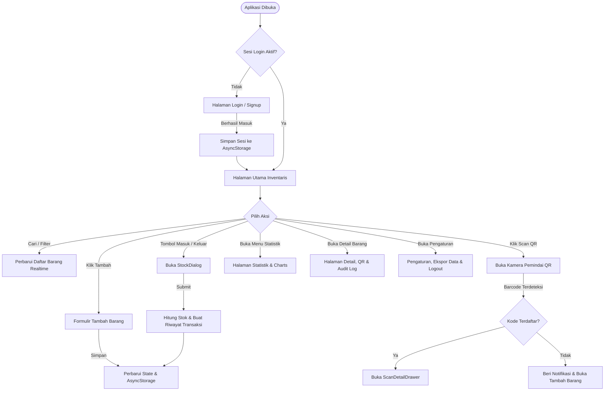

# Laporan Analisis Sistem: Warehouse Inventory Management SuperApp (InvyDrop)

---

## 1. Ringkasan Aplikasi
**Warehouse Inventory Management SuperApp** (di dalam aplikasi dinamai **InvyDrop**) adalah aplikasi seluler manajemen pergudangan dan inventaris logistik yang dirancang dengan pendekatan *offline-first*. Aplikasi ini ditujukan untuk staf gudang, petugas inventaris, dan manajer logistik guna memantau ketersediaan barang secara langsung, mencatat mutasi stok masuk dan keluar, mencetak/memindai kode QR barang, serta menganalisis kesehatan stok gudang tanpa memerlukan ketergantungan server pusat secara instan.

---

## 2. Tech Stack

Berdasarkan berkas [package.json](file:///d:/Mobile%20Programming%20Smt7/Warehouse%20Inventory%20Management%20SuperApp/package.json) dan konfigurasi proyek:

| Kategori | Teknologi & Pustaka | Versi | Keterangan |
| :--- | :--- | :--- | :--- |
| **Bahasa Pemrograman** | TypeScript | `~6.0.3` | Strict mode aktif ([tsconfig.json](file:///d:/Mobile%20Programming%20Smt7/Warehouse%20Inventory%20Management%20SuperApp/tsconfig.json)) |
| **Framework Utama** | React Native, Expo | React `19.2.3`, React Native `0.86.3`, Expo SDK `^57.0.27` | Native Mobile Application untuk Android & iOS |
| **Routing / Navigasi** | Expo Router | `~57.0.25` | File-system based routing via [src/app](file:///d:/Mobile%20Programming%20Smt7/Warehouse%20Inventory%20Management%20SuperApp/src/app) |
| **Penyimpanan Lokal** | AsyncStorage | `@react-native-async-storage/async-storage 2.2.0` | Penyimpanan persisten lokal offline-first |
| **Grafik & Visualisasi** | React Native Gifted Charts | `^1.4.81` | Diagram batang (*Bar Chart*) & lingkaran (*Pie Chart*) |
| **Kamera & Pemindai QR**| Expo Camera | `~57.0.6` | Pemindai QR barcode langsung melalui kamera gawai |
| **Generator QR** | React Native QRCode SVG | `^6.3.26` | Pembuatan visual kode QR berbasis SVG |
| **Ikon UI** | Lucide React Native | `^1.55.0` | Kumpulan ikon vektor modern |
| **UI Primitives** | Custom Design System | Native primitives | Komponen kustom meniru pola shadcn/ui di React Native |
| **Platform Berbagi** | Expo Sharing / RN Share | `~57.0.22` | Berbagi payload QR code & ekspor data inventaris |

*(Catatan: Berkas `README.md` lama menyebutkan Vite, React 18 Web, Tailwind CSS v4, dan Recharts, namun kode sumber sebenarnya telah bermigrasi penuh menjadi aplikasi seluler Expo / React Native).*

---

## 3. Struktur Folder

Pohon folder utama proyek (level 1–3):

```text
Warehouse Inventory Management SuperApp/
├── app.json                                 # Konfigurasi aplikasi Expo & metadata paket mobile
├── package.json                             # Dependensi & script eksekusi
├── tsconfig.json                            # Konfigurasi TypeScript dan path alias (@/*)
├── THIRD_PARTY_LICENSES.md                  # Atribusi dan lisensi pihak ketiga
├── README.md                                # Dokumentasi awal proyek
├── DOKUMENTASI_APLIKASI.md                  # Laporan analisis sistem lengkap
└── src/
    ├── app/                                 # Rute navigasi Expo Router
    │   ├── _layout.tsx                      # Root layout, provider wrappers (Auth, Theme, Inventory)
    │   ├── index.tsx                        # Rute halaman utama inventaris
    │   ├── statistics.tsx                   # Rute halaman statistik & analitik
    │   ├── settings.tsx                     # Rute halaman pengaturan & profil
    │   ├── login.tsx                        # Rute otentikasi masuk
    │   ├── signup.tsx                       # Rute registrasi pengguna baru
    │   ├── add-item.tsx                     # Rute formulir tambah barang
    │   └── item/
    │       ├── [id].tsx                     # Rute dinamis detail barang & riwayat
    │       └── edit/
    │           └── [id].tsx                 # Rute dinamis pengubahan informasi barang
    ├── assets/                              # Aset gambar & ilustrasi latar belakang
    ├── components/                          # Komponen antarmuka (UI screens & dialogs)
    │   ├── InventoryPage.tsx                # Tampilan utama daftar inventaris & filter
    │   ├── StatisticsPage.tsx               # Tampilan analitik dan grafik chart
    │   ├── SettingsPage.tsx                 # Tampilan preferensi, ekspor, dan akun
    │   ├── ItemDetailPage.tsx               # Tampilan detail barang & riwayat transaksi
    │   ├── AddItemPage.tsx / AddItemDialog  # Formulir input barang baru (halaman/modal)
    │   ├── EditItemPage.tsx                 # Formulir pengeditan atribut barang
    │   ├── StockDialog.tsx                  # Dialog cepat penambahan/pengurangan stok
    │   ├── ScanDetailDrawer.tsx             # Bottom drawer hasil pindaian barcode kamera
    │   ├── WebScannerSheet.tsx              # Modal kamera pemindai QR code
    │   ├── ItemQrDialog.tsx                 # Modal pratinjau dan pencetakan QR code
    │   ├── BottomNav.tsx                    # Bilah navigasi bawah dengan floating button
    │   ├── HeroBanner.tsx                   # Header banner visual dengan status koneksi
    │   ├── ProtectedRoute.tsx               # Penjaga rute terotentikasi
    │   └── ui/                              # Komponen dasar (Button, Card, Dialog, Drawer, Toast, dll.)
    ├── context/                             # State Management global via React Context
    │   ├── AuthContext.tsx                  # State sesi login & data pengguna
    │   ├── InventoryContext.tsx             # State data inventaris (CRUD & in-memory sync)
    │   └── StockHistoryContext.tsx          # State log mutasi transaksi stok
    ├── hooks/
    │   └── useQrScanner.ts                  # Custom hook pemicu modal scanner kamera
    └── theme/
        ├── tokens.ts                        # Desain token warna (Warm Claude Palette), tipografi, spacing
        └── ThemeProvider.tsx                # Penyedia tema (terang/gelap)
```

---

## 4. Daftar Fitur

### A. Otentikasi Pengguna & Penjaga Akses (Auth & Protected Routes)
- **Deskripsi & Cara Kerja**: Pengguna dapat mendaftar (*signup*) dengan nama, surel, dan kata sandi, serta masuk (*login*). Rute utama dilindungi oleh komponen pelindung yang secara otomatis mengarahkan pengguna yang belum masuk ke halaman login.
- **File Terkait**:
  - [src/context/AuthContext.tsx](file:///d:/Mobile%20Programming%20Smt7/Warehouse%20Inventory%20Management%20SuperApp/src/context/AuthContext.tsx)
  - [src/components/ProtectedRoute.tsx](file:///d:/Mobile%20Programming%20Smt7/Warehouse%20Inventory%20Management%20SuperApp/src/components/ProtectedRoute.tsx)
  - [src/components/LoginPage.tsx](file:///d:/Mobile%20Programming%20Smt7/Warehouse%20Inventory%20Management%20SuperApp/src/components/LoginPage.tsx)
  - [src/components/SignupPage.tsx](file:///d:/Mobile%20Programming%20Smt7/Warehouse%20Inventory%20Management%20SuperApp/src/components/SignupPage.tsx)

### B. Manajemen Inventaris & Pemantauan Stok (Inventory CRUD)
- **Deskripsi & Cara Kerja**: Menampilkan seluruh katalog barang gudang dengan metrik stok terkini, batas minimum stok, dan indikator status (*Aman*, *Menipis*, atau *Habis*). Pengguna dapat menambah barang baru secara manual atau otomatis digenerasikan kode SKU unik (`WH-XXXXXX`), mengedit rincian barang, serta menghapusnya dengan konfirmasi dialog.
- **File Terkait**:
  - [src/components/InventoryPage.tsx](file:///d:/Mobile%20Programming%20Smt7/Warehouse%20Inventory%20Management%20SuperApp/src/components/InventoryPage.tsx)
  - [src/components/AddItemPage.tsx](file:///d:/Mobile%20Programming%20Smt7/Warehouse%20Inventory%20Management%20SuperApp/src/components/AddItemPage.tsx)
  - [src/components/AddItemDialog.tsx](file:///d:/Mobile%20Programming%20Smt7/Warehouse%20Inventory%20Management%20SuperApp/src/components/AddItemDialog.tsx)
  - [src/components/EditItemPage.tsx](file:///d:/Mobile%20Programming%20Smt7/Warehouse%20Inventory%20Management%20SuperApp/src/components/EditItemPage.tsx)
  - [src/context/InventoryContext.tsx](file:///d:/Mobile%20Programming%20Smt7/Warehouse%20Inventory%20Management%20SuperApp/src/context/InventoryContext.tsx)

### C. Mutasi Stok Cepat (Quick Stock In / Out)
- **Deskripsi & Cara Kerja**: Tombol aksi langsung "Masuk" (+) dan "Keluar" (−) pada kartu inventaris dan lembar pindaian. Membuka dialog kalkulasi stok instan dengan validasi agar jumlah barang keluar tidak melebihi stok yang tersedia. Setiap aksi otomatis mencatat transaksi ke riwayat audit.
- **File Terkait**:
  - [src/components/StockDialog.tsx](file:///d:/Mobile%20Programming%20Smt7/Warehouse%20Inventory%20Management%20SuperApp/src/components/StockDialog.tsx)
  - [src/context/StockHistoryContext.tsx](file:///d:/Mobile%20Programming%20Smt7/Warehouse%20Inventory%20Management%20SuperApp/src/context/StockHistoryContext.tsx)

### D. Pemindaian Kode QR dengan Kamera Perangkat (QR Scanner)
- **Deskripsi & Cara Kerja**: Menggunakan `expo-camera` untuk membuka kamera gawai. Pengguna mengarahkan kamera ke label QR barang. Jika kode terdaftar, aplikasi langsung memunculkan lembar informasi cepat (*ScanDetailDrawer*) untuk mutasi kilat. Jika belum terdaftar, aplikasi menawarkan pembuatan barang baru dengan kode tersebut.
- **File Terkait**:
  - [src/components/WebScannerSheet.tsx](file:///d:/Mobile%20Programming%20Smt7/Warehouse%20Inventory%20Management%20SuperApp/src/components/WebScannerSheet.tsx)
  - [src/components/ScanDetailDrawer.tsx](file:///d:/Mobile%20Programming%20Smt7/Warehouse%20Inventory%20Management%20SuperApp/src/components/ScanDetailDrawer.tsx)
  - [src/hooks/useQrScanner.ts](file:///d:/Mobile%20Programming%20Smt7/Warehouse%20Inventory%20Management%20SuperApp/src/hooks/useQrScanner.ts)

### E. Generator & Pembagian Kode QR (QR Generator & Share)
- **Deskripsi & Cara Kerja**: Membuat kode QR interaktif dari kode SKU barang menggunakan `react-native-qrcode-svg`. Pengguna dapat membagikan teks metadata atau meneruskannya ke utilitas cetak label melalui native share sheet.
- **File Terkait**:
  - [src/components/ItemQrDialog.tsx](file:///d:/Mobile%20Programming%20Smt7/Warehouse%20Inventory%20Management%20SuperApp/src/components/ItemQrDialog.tsx)

### F. Riwayat Transaksi & Audit Log
- **Deskripsi & Cara Kerja**: Setiap mutasi stok (masuk, keluar, stok awal) dicatat dengan stempel waktu ISO, kuantitas, dan catatan operasional. Ditampilkan di halaman detail barang dalam urutan kronologis terbalik.
- **File Terkait**:
  - [src/components/ItemDetailPage.tsx](file:///d:/Mobile%20Programming%20Smt7/Warehouse%20Inventory%20Management%20SuperApp/src/components/ItemDetailPage.tsx)
  - [src/context/StockHistoryContext.tsx](file:///d:/Mobile%20Programming%20Smt7/Warehouse%20Inventory%20Management%20SuperApp/src/context/StockHistoryContext.tsx)

### G. Analitik & Dasbor Statistik (Analytics Dashboard)
- **Deskripsi & Cara Kerja**: Menganalisis data inventaris secara visual dengan:
  - Ringkasan KPI: *Total Items*, *Total Stock*, *Low Stock Warning*, dan *Out of Stock*.
  - Diagram batang (*Bar Chart*) kuantitas stok per kategori barang.
  - Diagram lingkaran (*Pie Chart*) rasio ketersediaan stok (*In Stock*, *Low Stock*, *Out of Stock*).
- **File Terkait**:
  - [src/components/StatisticsPage.tsx](file:///d:/Mobile%20Programming%20Smt7/Warehouse%20Inventory%20Management%20SuperApp/src/components/StatisticsPage.tsx)

### H. Pencarian & Penyaringan Instan (Search & Filtering)
- **Deskripsi & Cara Kerja**: Bilah pencarian teks bebas yang menyaring nama barang, kode SKU, kategori, atau lokasi gudang secara *real-time*, dipadukan dengan *filter chips* status stok (Semua, Menipis, Aman).
- **File Terkait**:
  - [src/components/InventoryPage.tsx](file:///d:/Mobile%20Programming%20Smt7/Warehouse%20Inventory%20Management%20SuperApp/src/components/InventoryPage.tsx)

### I. Pengaturan & Manajemen Cadangan Data (Settings & Export)
- **Deskripsi & Cara Kerja**: Menampilkan profil pengguna yang aktif, opsi pengubahan preferensi tema (Terang, Gelap, Sistem), fitur pencadangan/ekspor seluruh data inventaris dalam format teks JSON melalui sistem *Share*, serta penghapusan data secara menyeluruh.
- **File Terkait**:
  - [src/components/SettingsPage.tsx](file:///d:/Mobile%20Programming%20Smt7/Warehouse%20Inventory%20Management%20SuperApp/src/components/SettingsPage.tsx)

---

## 5. Alur Aplikasi

### Alur Utama Pengguna & Mutasi Data



---

## 6. Database & Data Model

Aplikasi ini menggunakan **AsyncStorage** (kunci-nilai lokal) pada sisi klien. Tidak ada tabel SQL atau database relasional eksternal.

### Skema Entitas Data (TypeScript Interfaces)

#### 1. Entitas Barang (`InventoryItem`)
Disimpan di kunci penyimpanan `'warehouse-inventory'`:
```typescript
export interface InventoryItem {
  id: string;          // Unik ID (string alfanumerik acak)
  code?: string;       // Kode SKU barang unik (cth: 'WH-FL8921')
  name: string;        // Nama barang
  category: string;    // Kategori (cth: 'Packaging', 'Electronics')
  quantity: number;    // Jumlah unit stok saat ini
  minStock: number;    // Ambang batas minimum stok aman
  location: string;    // Titik lokasi rak/lorong gudang (cth: 'Aisle B - Bay 04')
  notes?: string;      // Catatan operasional/penanganan
  createdAt: string;   // Timestamp ISO pembuatan barang
}
```

#### 2. Entitas Transaksi Mutasi (`StockTransaction`)
Disimpan di kunci penyimpanan `'warehouse-stock-history'`:
```typescript
export interface StockTransaction {
  id: string;                    // ID transaksi acak
  itemId: string;                // ID referensi ke InventoryItem
  type: 'masuk' | 'keluar' | 'awal'; // Jenis mutasi
  quantity: number;              // Jumlah barang yang dimutasi (nilai positif)
  note?: string;                 // Keterangan transaksi opsional
  createdAt: string;             // Timestamp ISO terjadinya mutasi
}
```

#### 3. Entitas Pengguna (`User`)
Disimpan di kunci `'warehouse-users'` (daftar akun terdaftar) dan `'warehouse-user'` (sesi aktif):
```typescript
export interface User {
  id: string;        // ID pengguna
  email: string;     // Alamat surel unik
  name: string;      // Nama lengkap
  password?: string; // Kata sandi tersimpan (disimpan di daftar pengguna)
}
```

---

## 7. API / Endpoint

> **Status:** **Tidak ditemukan / Tidak ada (Client-Only Offline Architecture)**.

Aplikasi tidak terhubung ke API backend eksternal, REST API, GraphQL, Firebase, atau Supabase. Semua operasi pemrosesan data, validasi, dan persistensi dieksekusi 100% secara lokal pada perangkat melalui React Context API dan AsyncStorage.

---

## 8. Konfigurasi & Cara Menjalankan

### Kebutuhan Environment & Prasyarat
- **Node.js**: Versi `>= 18.x` atau versi LTS yang direkomendasikan.
- **Package Manager**: `npm` atau `yarn` / `pnpm` / `bun`.
- **Expo CLI**: Terintegrasi langsung via dependensi proyek.
- **Expo Go App** (di ponsel fisik Android/iOS) atau **Android Studio / Xcode Emulator**.
- **Environment Variable**: Tidak ada berkas `.env` atau kunci API rahasia yang diwajibkan untuk menjalankan aplikasi.

### Langkah Instalasi & Menjalankan

1. **Buka terminal dan pasang dependensi**:
   ```bash
   npm install
   ```

2. **Jalankan server pengembangan Expo**:
   ```bash
   npm run start
   # atau: npx expo start
   ```

3. **Menjalankan pada target perangkat**:
   - Untuk **Android Emulator / Device**: Tekan tombol `a` di terminal atau jalankan `npm run android`.
   - Untuk **iOS Simulator** (khusus macOS): Tekan tombol `i` di terminal atau jalankan `npm run ios`.
   - Untuk **Ponsel Fisik**: Pindai QR Code di terminal menggunakan aplikasi **Expo Go** pada ponsel (pastikan perangkat dan komputer berada di jaringan Wi-Fi yang sama).

---

## 9. Catatan Kualitas Kode

### Kekuatan
1. **Pola Desain Bersih & Modular**: Pemisahan komponen UI, konteks logika (*separation of concerns*), dan rute halaman diatur rapi dengan konvensi [Expo Router](file:///d:/Mobile%20Programming%20Smt7/Warehouse%20Inventory%20Management%20SuperApp/src/app).
2. **Arsitektur Offline-First yang Cepat**: Aplikasi dapat berjalan lancar tanpa jaringan internet; semua mutasi langsung tersinkronisasi ke memori lokal gawai.
3. **Penyediaan Data Awal (Seed Data)**: Terdapat data contoh suku cadang/barang gudang di [InventoryContext.tsx](file:///d:/Mobile%20Programming%20Smt7/Warehouse%20Inventory%20Management%20SuperApp/src/context/InventoryContext.tsx#L52-L95) yang memudahkan pengujian awal tanpa harus mengisi dari nol.
4. **Desain Visual & Aksesibilitas Terpadu**: Palet tema yang konsisten (*Claude warm orange*), transisi dialog yang halus, serta penyediaan status visual yang jelas (*Aman*, *Menipis*, *Habis*).

### Kelemahan, Potensi Bug, & Risiko Keamanan
1. **Penyimpanan Kata Sandi Berbahaya (Plaintext Password)**:
   Pada [AuthContext.tsx](file:///d:/Mobile%20Programming%20Smt7/Warehouse%20Inventory%20Management%20SuperApp/src/context/AuthContext.tsx#L63), kata sandi akun disimpan dalam teks biasa (*plaintext*) ke dalam `AsyncStorage`. Siapa pun yang memiliki akses ke memori fisik/cadangan gawai dapat mengekstrak kata sandi tersebut.
2. **Implementasi Dark Mode Belum Sempurna**:
   Di [SettingsPage.tsx](file:///d:/Mobile%20Programming%20Smt7/Warehouse%20Inventory%20Management%20SuperApp/src/components/SettingsPage.tsx#L27), tombol toggle tema hanya memodifikasi state lokal komponen, belum terhubung ke `toggleTheme()` dari [AppThemeProvider](file:///d:/Mobile%20Programming%20Smt7/Warehouse%20Inventory%20Management%20SuperApp/src/theme/ThemeProvider.tsx). Akibatnya, pergantian tema tidak berdampak ke seluruh aplikasi.
3. **Pemberian Keterangan Dokumentasi Usang di README**:
   Berkas [README.md](file:///d:/Mobile%20Programming%20Smt7/Warehouse%20Inventory%20Management%20SuperApp/README.md) mendokumentasikan stack web (`pnpm dev`, `Vite`, `Recharts`, `Tailwind v4`), yang tidak mencerminkan basis kode React Native / Expo saat ini.
4. **Navigasi Tombol Tambah di Lembar Pindaian**:
   Di [Layout.tsx](file:///d:/Mobile%20Programming%20Smt7/Warehouse%20Inventory%20Management%20SuperApp/src/components/Layout.tsx#L47), ketika QR tidak ditemukan, aplikasi memanggil `openAddItem(code)` yang membuka `AddItemDialog` global, padahal rute baru pembuatan barang kini menggunakan halaman khusus [AddItemPage.tsx](file:///d:/Mobile%20Programming%20Smt7/Warehouse%20Inventory%20Management%20SuperApp/src/components/AddItemPage.tsx). Hal ini menyebabkan duplikasi komponen formulir tambah barang.

---

## 10. Saran Pengembangan

1. **Sinkronisasi Cloud / Backend Terpusat**:
   Tambahkan integrasi backend berbasis REST/GraphQL (misalnya Node.js, Go, atau BaaS seperti Supabase/Firebase) agar data gudang dapat disinkronkan secara *multi-user* di antara beberapa staf gudang dalam waktu nyata.
2. **Keamanan Autentikasi**:
   Gunakan library kriptografi (seperti `expo-crypto`) untuk melakukan *hashing* (SHA-256 / bcrypt) sebelum menyimpan kredensial ke penyimpanan lokal, atau ganti dengan sistem token JWT yang aman.
3. **Ekspor & Impor Dokumen Resmi (PDF & Excel/CSV)**:
   Perluas fitur ekspor data yang saat ini berupa teks JSON mentah menjadi berkas lembar sebar (.xlsx/.csv) atau cetak laporan stok (.pdf) untuk mempermudah proses audit inventaris berkala.
4. **Sinkronisasi Tema Global**:
   Hubungkan pemilih tema di `SettingsPage` langsung ke `AppThemeProvider` dan simpan preferensi tema ke `AsyncStorage` agar pilihan mode gelap/terang pengguna tersimpan permanen.
5. **Pembaruan Berkas Dokumentasi**:
   Sesuaikan instruksi pada berkas `README.md` agar mencerminkan panduan instalasi dan penggunaan Expo CLI React Native yang sesungguhnya.
